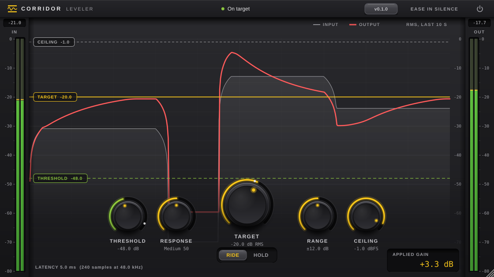
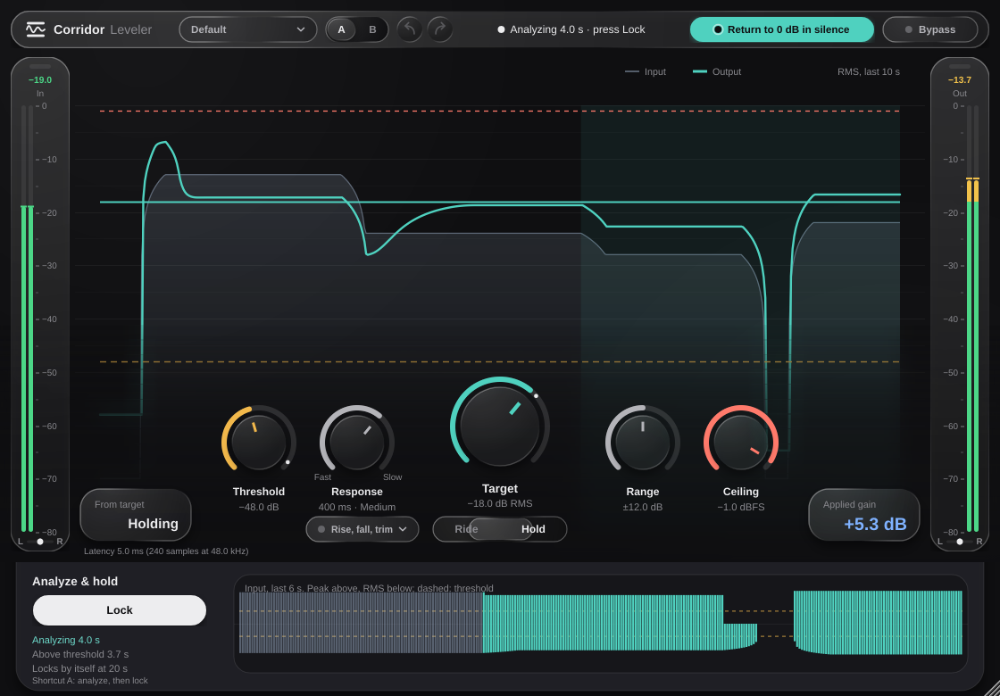

# Corridor Leveler

An automatic level rider for streaming and recording. Set a target and Corridor keeps your audio
there: quiet passages are lifted, loud ones lowered, silence and room noise are never boosted, and
the output never goes past the ceiling. A Windows plugin (VST3 and 2.x) for OBS and any Windows DAW.



## Formats

| Build | File | Where it's used |
|---|---|---|
| 2.x plugin | `Corridor Leveler.dll` | OBS → Filters → **VST 2.x Plug-in** → Corridor Leveler (full plugin window); DAWs |
| VST3 | `Corridor Leveler.vst3` | DAWs |

Both run the same engine (`core/`). Mono and stereo, at whatever sample rate the host uses.

## Controls

- **Ride / Hold**: Ride adjusts the gain continuously. Hold slides an analysis sheet out under the window:
  press **Analyze** (or the **A** key), play a typical section while the live input waveform lights up, then
  press **Lock** (or it locks after 20 s). One fixed correction is then held. Analyze / Lock is also a host
  parameter, so a hotkey, Stream Deck or MIDI button can press it: each press analyzes, the next locks.
- **Threshold** (dB RMS): below this it stops adjusting, so silence, breaths and noise never trigger a boost.
- **Target** (dB RMS): the level you want. The default is −18.
- **Response** (ms): how long Corridor listens before it judges the level. 10 ms is the fastest and follows
  almost every word; 3000 ms is the slowest and rides whole phrases. The dial is marked Fast and Slow and
  runs on a log scale. Drums are detected and stretch it up to 3x (at most 0.8 s), so the gain follows the
  groove, not each hit. Below about 50 ms the leveler starts to shape the sound itself, like a compressor.
- **Range** (dB): the most it may boost or cut.
- **Ceiling** (dBFS, −60 to 0): the highest peak allowed. Boosts stop short of it and a 5 ms look-ahead
  brick-wall limiter catches the rest. Half the dial covers −12 to 0, where it is usually set.
- **Rise, fall, trim** (the button next to Ride / Hold opens them):
  - **Rise** (ms): how fast quiet passages are lifted.
  - **Fall** (ms): how fast loud passages are pulled down. A slow rise and a fast fall suit voice.
  - **Output trim** (dB): a final +/-12 dB after the leveler, still under the ceiling.
- **Return to 0 dB in silence** (on by default): after 2 s of silence the gain glides back to 0 dB. Off, the
  gain freezes below the threshold instead.
- **Bypass**: click-free, and keeps the same latency so nothing jumps. While bypassed the button turns red
  and reads **Bypassed**.

Also in the header: **presets** (Stream voice, Podcast, Music bed, Drums, Quiet room), **A / B** (two complete
settings to compare; B starts as a copy of A, and both are saved with the session), and **undo / redo**
(Ctrl+Z, Ctrl+Shift+Z) for every change. Double-click a dial, or press Enter on it, to type a value;
Alt-click resets it.

The window is a full-bleed level graph with the header, meters and readouts floating over it as glass, and
the controls sitting in the graph where it frosts over. It can be resized from 480 to 2240 px wide and keeps
its shape. Every on/off button shows its state the same way: off is plain glass with a grey dot, on is filled
with colour and the dot lights. The meters show left and right with a balance dot, in green, amber and red
zones, marked at the graph's heights. The bottom corners show how far the output is from the target and the applied gain; the latency is under them
(5 ms at every sample rate). A one-time tip explains the two settings that matter most.



## Installing

Download the latest **CorridorLeveler-…-Windows-Setup.exe** from [Releases](../../releases/latest), run it,
and restart OBS. See `installer/README.txt` for where each part goes.

## Updates

When the plugin window opens, Corridor asks this repository's public GitHub releases for the newest
version. It is a plain request with no token and nothing about you or your computer. If a newer
version exists, it asks once per session, with **Update** and **Ignore**:

- **Update** downloads the installer with a progress bar and opens it. Close OBS or your DAW when the
  installer asks; settings and sessions are kept.
- **Ignore** stops the automatic prompt for that version. The next version asks again.
- The version button in the header opens a panel with the installed version, the last result and
  **Check for updates**, which always asks, even about an ignored version.
- Offline, it uses the last answer it saved.

## Versions and releases

Every commit that lands on `main` builds the installer and publishes it as a new GitHub Release.
The version is `MAJOR.MINOR.N`: `MAJOR.MINOR` comes from the `VERSION` file and `N` is the number of
commits on `main`, so it goes up by itself. To start a new minor or major version, edit `VERSION`
(for example `0.2` or `1.0`). The same number is built into the plugins, the installer and the release tag.

## Building

```bash
cmake -S . -B build -DCMAKE_BUILD_TYPE=Release
```

```bash
cmake --build build --config Release --parallel
```

```bash
ctest --test-dir build --output-on-failure
```

JUCE and FST are downloaded at configure time. Corridor Leveler ships for Windows only;
the CI also builds on Linux purely to run the tests and render the window screenshots (that needs ALSA, X11,
FreeType and Fontconfig development libraries). Options: `CORRIDOR_BUILD_PLUGIN`,
`CORRIDOR_BUILD_VST2`, `CORRIDOR_BUILD_TESTS`.

Tests:

- `tests/test_core.cpp`: engine behaviour at 44.1 to 192 kHz: reaching the target, stereo linking, threshold
  freeze, ease, range, ceiling, bit-exact bypass delay, Hold/Analyze, drums vs voice, mono.
- `tests/plugin_check.cpp`: loads the built VST3 and 2.x binaries like a host, checks level, latency and
  bypass, and renders the window to PNG.

## Licences

Corridor Leveler is licensed under the **GNU AGPL v3 or later** (see `LICENSE`).

- [JUCE](https://juce.com) is used under its AGPLv3 open-source licence.
- The 2.x plugin is built with [FST](https://git.iem.at/zmoelnig/FST) (GPLv3 or later), an independent
  reimplementation of the 2.x plugin headers, because Steinberg no longer distributes that SDK.
  "VST" is a Steinberg trademark. FST's authors ask that plugins built with FST not be called "VST"
  or "VST compatible", so this project refers to that build as the 2.x plugin.
